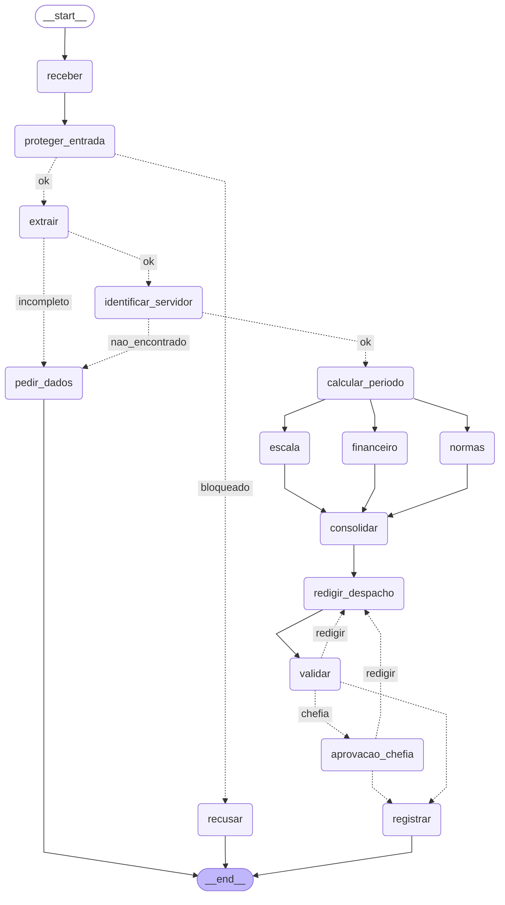

# Entrega: Assistente de Gestão de Pessoas

**Aluno(s):** Valdeci Cardoso da Mata Filho
**Até onde chegou:** ( ) Marco mínimo (Etapa 6)  ( ) Marco completo (Etapa 9)  (x) Etapas 10–11
**Opcionais e bônus feitos:** ( ) 🆕 A  ( ) 🆕 B  ( ) 🆕 C  ( ) Outro: ______

## Etapa 0: quem verifica cada regra?

| Regra | Tema | Quem verifica (função Python / agente / humano) | Por quê | Onde foi implementada (preencha na Etapa 11) |
|---|---|---|---|---|
| N1 | férias | Função Python | É conta: comparar dias com `saldo_ferias_dias`, contar períodos (≤ 3) e checar o mínimo de 5 dias. Resultado exato e determinístico, sem interpretação. | `etapa06_regras.py` → `violacoes_objetivas()`, chamada no nó `consolidar` (`etapa07_grafo.py`) |
| N2 | férias | Função Python | É conta: dias vendidos ≤ 10, gozados + vendidos ≤ saldo e valor = `salario_base / 30`. Valor em dinheiro não pode depender do LLM (o salário é dado restrito). | Limites: `violacoes_objetivas()`; `dias_vendidos` com `ge=0, le=10` no `Pedido` (`etapa02_extracao.py`); valor: agente Financeiro com `consultar_remuneracao` (MCP, tool restrita) |
| N3 | férias | Função Python (+ API/cache de feriados) | É calendário: ver se o início cai numa quinta/sexta ou nos 2 dias antes de um feriado. Basta o dia da semana e a lista de feriados. | `etapa04_ferramentas.py` → `inicio_permitido()` + `buscar_feriados()` (BrasilAPI, plano B e cache); usada em `violacoes_objetivas()` |
| N4 | prazos | Função Python | É conta de datas: diferença entre a data do pedido e o início (30 dias, 2 dias úteis ou 10 dias, conforme o tipo). | `etapa06_regras.py` → `violacoes_objetivas()` e `_dias_uteis_ate()` |
| N5 | escala | Função Python | É conta: afastados da equipe que se sobrepõem ao período vs. limite `max(1, floor(30% da equipe))`, sem contar o próprio servidor. (O agente de escala só **sugere** outro período; quem decide se há conflito é o código.) | `dados_rh.escala_da_equipe()` via tool MCP `consultar_escala`; conflito em `violacoes_objetivas()`; sugestão de datas no agente Escala (`etapa06_agentes.py`) |
| N6 | abono | Função Python | É conta/calendário: 1 dia útil, não é fim de semana nem feriado, e `abonos_restantes` > 0. | `etapa06_regras.py` → `violacoes_objetivas()` (`eh_dia_util()` da Etapa 4) |
| N7 | diária | Função Python (+ API de cotação) | É conta: 1 diária por pernoite + ½ no retorno × valor de `diarias.csv`; no exterior, × cotação do USD do dia. O agente financeiro pode explicar, mas o número vem da função. | Nó `financeiro` (`etapa07_grafo.py`): quantidade × `tabela_diarias` (MCP) × `cotacao_usd_brl()` (API, Etapa 4), em Python; o agente Financeiro só redige o parecer |
| N8 | aprovação | Humano (chefia imediata) | Deferir férias/diária é **decisão de alguém** com responsabilidade, não conta nem interpretação: o fluxo pausa e espera a chefia. A parte objetiva (abono dispensa chefia; quem aprova é a chefia do cadastro e nunca o próprio servidor) é checada em Python no servidor MCP. | Humano: nó `aprovacao_chefia` com `interrupt()` + `retomar()`; quem precisa: `precisa_chefia()`; autorização: `registrar_decisao` no `etapa05_mcp_rh.py` (autoaprovação e chefia errada → DENY) |
| N9 | saúde | Função Python (guardrail de entrada, regex) + agente classificador de apoio | A parte objetiva (CID, laudo) é pega por regex **antes** de qualquer agente ver o texto: dado de saúde não pode nem chegar ao LLM. Como nem todo pedido de saúde tem CID ("estou com depressão"), o classificador de escopo (agente) cobre o que a regex não pega. O pedido é bloqueado e orientado à junta médica. | `etapa03_guardrails.py` → `encontrar_dado_sensivel()` + classificador; nó `proteger_entrada`; `rotear_extracao` desvia `licenca_saude` para `pedir_dados` |
| N10 | dados | Função Python (guardrail de saída) | Antes de registrar, o despacho passa por uma validação determinística (regex de CPF/CID). Não se confia só na instrução do agente redator: a checagem final tem que ser garantida, não provável. | `problemas_do_despacho()` no nó `validar` + guardrail de saída no `registrar` (`bloqueado_na_saida`), ambos em `etapa07_grafo.py` |

## Etapa 11: os 12 casos

Compare **caminho e estado**, não o texto do despacho.

Rodado a partir de `saidas/` vazia com `python etapa07_grafo.py --todos` e depois `--retomar C2_ferias_com_venda sim 1010` e
`--retomar C11_diaria_exterior sim 1011`. "Completo" = `receber -> proteger_entrada -> extrair -> identificar_servidor ->
calcular_periodo -> escala -> financeiro -> normas -> consolidar -> redigir_despacho -> validar` (os três ramos em paralelo).

| Caso | Caminho percorrido | Resultado (bloqueado / pediu dados / triagem humana / indeferido / pausou na chefia / registrado + protocolo) | Bateu com o esperado? |
|---|---|---|---|
| C1_abono_simples | completo `-> registrar` | registrado (deferido, sem chefia) — `ae788d33` | Sim |
| C2_ferias_com_venda | completo → **pausa** em `aprovacao_chefia` → (sim 1010) `aprovacao_chefia -> registrar` | pausou na chefia → registrado (deferido pela 1010, venda R$ 3.166,67) — `b7b6f485` | Sim |
| C3_dado_de_saude | `receber -> proteger_entrada -> recusar` | bloqueado (CPF/CID, sem chamar o LLM) | Sim |
| C4_fora_do_escopo | `receber -> proteger_entrada -> recusar` | bloqueado (fora do escopo) | Sim |
| C5_sem_matricula | `receber -> proteger_entrada -> extrair -> pedir_dados` | pediu dados (sem matrícula e sem datas exatas) | Sim |
| C6_conflito_de_escala | completo `-> registrar` | registrado (**indeferido**, N5; sugere 27/07 a 10/08/2027) — `6f1b47d7` | Sim |
| C7_autoaprovacao | `receber -> proteger_entrada -> recusar` | bloqueado (manipulação / "eu aprovo") | Sim |
| C8_idempotencia | completo `-> registrar` (igual ao C1) | **duplicado** (o server não grava de novo) — `ae788d33` | Sim |
| C9_divergencia | `receber -> proteger_entrada -> extrair -> pedir_dados` | pediu dados (pedido vago: "perto da Páscoa", sem datas exatas) | Sim |
| C10_zona_cinzenta | `receber -> proteger_entrada -> extrair -> pedir_dados` | pediu dados (nota 0,50 < LIMIAR 0,7; sem datas exatas) | Sim |
| C11_diaria_exterior | completo → **pausa** em `aprovacao_chefia` → (sim 1011) `aprovacao_chefia -> registrar` | pausou na chefia → registrado (deferido pela 1011; 3,5 × USD 320 = R$ 5.618,48) — `ec67dba1` | Sim |
| C12_inicio_proibido | completo `-> registrar` | registrado (**indeferido**, N3: começa numa sexta, véspera de feriado) — `7c458e62` | Sim |

## O grafo

## Etapa 4 (pronta): o que eu entendi

- Diferença entre a saída online e a offline: offline, cada API falha 3 vezes (linhas `[retry]`), os feriados vêm do arquivo local (plano B, 1,5 s de espera) e a cotação vira `None` ("a calcular"); online não há retry, os feriados vêm da BrasilAPI (0,3 s) e a cotação é real (5,0165). A API trouxe 14 feriados e o arquivo 13 (a mais, a segunda de Carnaval), mas as contas de datas e o protocolo saíram iguais.
- Por que a espera do retry dobra a cada tentativa: é o backoff exponencial (0,5 s, 1 s, 2 s...). Se a API caiu ou está sobrecarregada, insistir no mesmo ritmo piora; dobrar a espera dá tempo para ela se recuperar e limita quanto se espera antes do plano B.
- Por que o protocolo é um hash dos campos (e não um número sequencial): o hash é determinístico, então o mesmo pedido gera sempre o mesmo protocolo (C1 = C8 = `ae788d33`). Isso dá idempotência: um reenvio ou nova tentativa cai no mesmo protocolo e não duplica o registro, sem precisar de um contador central.
- O que aconteceria sem o cache de feriados: `dias_uteis()` e `inicio_permitido()` perguntam dia a dia se a data é feriado; cada consulta viraria uma chamada HTTP. Seriam dezenas de chamadas por pedido, lento, com risco de bloqueio por excesso de requisições e, com a API fora, 1,5 s de retry para cada dia.

## Observabilidade (C2)

- Onde o tempo foi gasto: nos três especialistas (normas 8,3 s, escala 5,8 s, financeiro 4,9 s), que rodam em paralelo, então o passo leva o tempo do mais lento (~8,3 s). Os nós que chamam o MCP sem LLM (`identificar_servidor` 2,5 s, `calcular_periodo` 2,9 s) são lentos porque cada `chamar_mcp` sobe o server de novo. `receber`, `consolidar` e `validar` (Python puro) levam ~0 s. O `segundos_total` do resumo (31,4 s) soma os ramos paralelos e superestima o tempo real (~21 s).
- Tokens totais: 6.523

## Opcionais (preencha só os que fez)

- 🆕 A: não feito
- 🆕 B: não feito
- 🆕 C: não feito

## Reflexão (até 3 linhas cada)

1. Quem decide o caminho no seu sistema: o LLM, o grafo, as regras ou um humano? Dê um exemplo de cada.
   **LLM:** interpreta o texto (o extrator decide que "agosto de 2027" não é data exata) e o classificador dá a nota de escopo. **Grafo:** os roteadores escolhem a aresta (`rotear_extracao` manda o C5 para `pedir_dados`). **Regras:** `violacoes_objetivas()` indefere o C6 (N5) e o C12 (N3). **Humano:** a chefia aprova ou rejeita o C2 e o C11 no `interrupt()`.
2. Se o guardrail de entrada falhar, o que ainda impede uma autoaprovação?
   As regras objetivas em Python (o C7 sem guardrail foi indeferido por N1, N2 e N4); a pausa da chefia, já que férias e diárias deferidas só seguem com resposta humana; e o server MCP, que nega `aprovador == matricula` e aprovador diferente da chefia do cadastro, registrando DENY na auditoria.
3. Por que o nó da chefia não pode gravar nada antes do `interrupt()`?
   Porque na retomada o LangGraph roda o nó de novo desde o começo (o print "ANTES do interrupt" apareceu outra vez a cada retomada). Uma gravação antes do `interrupt()` seria executada duas vezes, ou aconteceria antes da decisão da chefia.
4. Qual dado veio do **MCP**, qual de **API externa** e qual de **tool local**? Por que essa divisão?
   **MCP:** cadastro do servidor, escala, normas, tabela de diárias, salário e o registro da decisão. **API externa:** feriados (BrasilAPI) e cotação do dólar. **Local:** as contas (`violacoes_objetivas`, `resumo_periodo`, `gerar_protocolo`). Dado interno e sensível fica atrás do MCP, com token, N8 e auditoria; dado público vem de API com retry e plano B; conta pura é Python, sem rede.
5. O que você mudaria para colocar este sistema em produção?
   Uma sessão MCP persistente (cada chamada hoje sobe o server: ~2,5 s), banco de verdade em vez de JSON/SQLite local, token por serviço guardado num cofre e login real da chefia em vez do "1010" digitado. Todas as contas de valor em Python (o LLM errou as diárias várias vezes), testes de regressão com os 12 casos a cada mudança de prompt ou de modelo, e logs sem dado restrito com alertas de DENY, tempo e custo.

## De onde veio cada parte

| Arquivo / trecho | Exemplo das aulas em que me baseei | O que precisei adaptar |
|---|---|---|
| `etapa01_agente.py` (tool + AtendenteRH) | `aula1/segundo_agente.py`, `exercicios_resolvidos/aula4/ex10_function_tool.py` | Docstring dizendo quando usar a tool e instruções dizendo quando **não** usar (pergunta conceitual) |
| `etapa02_extracao.py` (`Pedido`) | `aula2/agente_output2.py` | Descrições das datas com "null se não disse o dia exato" para o C5 não inventar datas |
| `etapa03_guardrails.py` | `aula2/agente_guardrail.py`, `exercicios_resolvidos/aula4/ex11_guardrails.py` | Exemplos de manipulação ("ignore as regras", "eu aprovo") para pegar o C7; o guardrail de escopo não manda ao LLM texto com CPF/CID (os dois rodam em paralelo) |
| `etapa05_mcp_rh.py` (leitura, escrita, 9.2, 9.3) | `aula6/desafio2/mcp_unidades.py`, `aula3/agente_retry3.py`, `aula5/exemplos/10_seguranca/server_seguro.py` | Toda tool devolve um dict; autorização (token, enum, N8) antes da idempotência; auditoria em JSON Lines sem token e sem despacho |
| `etapa05_cliente_mcp.py` (5.3) | `aula5/exemplos/04_agente_mcp/agente.py` | O AtendenteRH troca a tool local pelo server inteiro |
| `etapa06_agentes.py` (especialistas e Coordenador) | `aula4/ex03_agente_as_tool.py`, `aula7/exemplos/02_agentes_especializados/main.py` | Regras obrigatórias nas instruções (Financeiro só quando há valor, salário só na venda) e Redator com datas DD/MM/AAAA e fechamento "Pedido DEFERIDO/INDEFERIDO" |
| `etapa06_linear.py` | `aula6/exemplos/01_fluxo_linear/main.py` | Quantidade de diárias (N7) calculada em Python antes do Coordenador |
| `etapa07_grafo.py` (nós, paralelismo, ciclo) | `aula6/desafio2/main.py`, `aula7/exemplos/08_paralelismo/main.py`, `aula6/exemplos/08_fluxo_ciclico/main.py` | Reducer em `violacoes`/`tokens`/`eventos`; Financeiro e Escala pulam o LLM quando não se aplicam; valor da N7 todo em Python |
| `etapa07_grafo.py` (chefia, Etapa 8) | `aula7/exemplos/07_aprovacao_revisao/main.py`, `aula7/exemplos/06_human_in_the_loop/main.py` | Rejeição zera as tentativas de validação; retomar sem pausa responde "nada pausado" |
| `etapa07_grafo.py` (`registrar`, 9.4) | `aula8/exemplos/05_guardrail_saida/1_codigo_pronto/main.py` | Resultado distingue `registrado`, `duplicado`, `negado_pelo_server: motivo` e `bloqueado_na_saida` |
| `etapa10_governanca.py` / `etapa10_observabilidade.py` | `aula3/agente_hook2.py`, `aula8/exemplos/03_observabilidade/1_codigo_pronto/passo1_trace.py` | Resultado de tool restrita (salário) mascarado no log; tokens do classificador e do extrator lidos por um contador `USO` |
